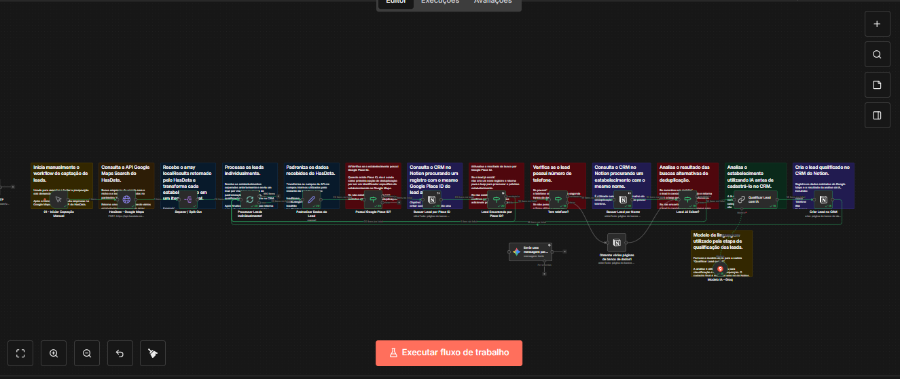
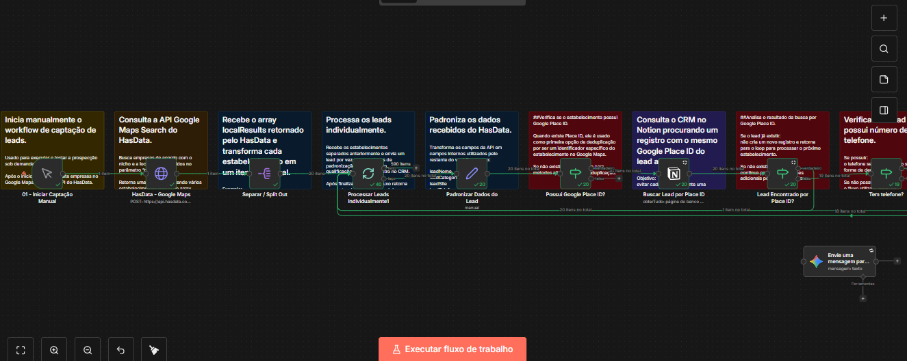
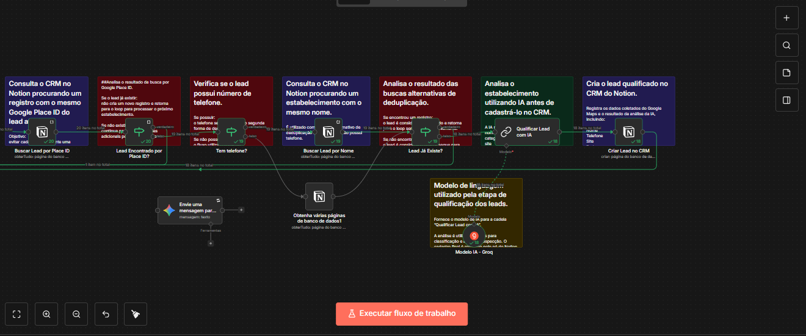
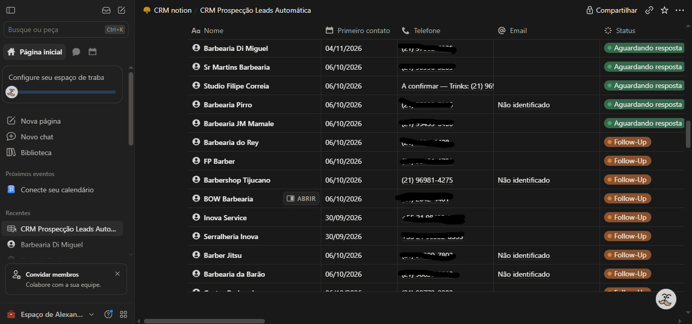

# Captação Automática de Leads com IA

Automação de captação, processamento, deduplicação e qualificação inteligente de leads utilizando **n8n, HasData, Groq AI e Notion CRM**.

## Sobre o projeto

Este projeto automatiza a identificação e organização de potenciais clientes para empresas que oferecem serviços digitais, como criação de sites, sistemas de agendamento, automações e soluções com inteligência artificial.

A solução busca estabelecimentos no Google Maps, padroniza suas informações, verifica possíveis duplicidades e utiliza IA para classificar oportunidades comerciais.

## Tecnologias utilizadas

- **n8n:** orquestração e automação do workflow.
- **HasData:** coleta de dados de estabelecimentos do Google Maps.
- **Groq AI:** qualificação inteligente dos leads.
- **Notion API:** armazenamento e gerenciamento dos leads em um CRM.
- **GitHub:** versionamento e documentação do projeto.

## Como funciona

1. **Configuração da busca:** define o nicho e a localização desejada.
2. **Captura de leads:** consulta estabelecimentos utilizando a API da HasData.
3. **Processamento:** separa os resultados e padroniza os dados.
4. **Deduplicação:** verifica a existência de registros utilizando Google Place ID, telefone e nome.
5. **Qualificação com IA:** classifica os leads por prioridade e oportunidade comercial.
6. **Cadastro no CRM:** registra os novos leads no Notion com as informações coletadas e a análise da IA.

## Demonstração visual

### Visão geral do workflow



### Execução da automação





### CRM no Notion



## Critérios de qualificação

A IA classifica os estabelecimentos considerando as informações disponíveis:

**Prioridade**
- Alta
- Média
- Baixa

**Oportunidade**
- Site
- Agendamento
- Automação
- IA

Também gera uma análise textual para justificar a classificação.

n8n-lead-capture-ai/
├── workflow/
│   └── lead-capture-workflow.json
├── docs/
│   ├── architecture.md
│   ├── setup-guide.md
│   └── workflow-explanation.md
├── images/
│   ├── notion-crm.png
│   ├── workflow-execution.png
│   ├── workflow-execution2.png
│   └── workflow-overview.png
├── .gitignore
└── README.md

## Como utilizar

### Pré-requisitos

- n8n instalado e funcionando.
- Conta e chave de API da HasData.
- Credencial da Groq.
- Conta Notion com uma integração autorizada e um banco de dados preparado.

### Instalação

1. Clone o repositório:

```bash
git clone https://github.com/Alegomes2/n8n-lead-capture-ai.git
```

2. Acesse o diretório:

```bash
cd n8n-lead-capture-ai
```

3. Importe `workflow/lead-capture-workflow.json` no n8n.

4. Configure suas próprias credenciais da HasData, Groq e Notion.

5. Selecione seu banco de dados do Notion nos quatro nós correspondentes.

6. Configure o nicho e a localização da busca.

7. Revise as configurações e execute o workflow.

## Segurança

O arquivo disponibilizado no repositório não deve conter credenciais ou tokens de acesso.

Cada usuário deve configurar suas próprias credenciais no n8n e selecionar seu próprio banco de dados do Notion.

Nunca publique chaves de API, tokens ou dados privados.

## Observações

Este repositório disponibiliza uma versão sanitizada do workflow. A configuração das integrações e credenciais é responsabilidade de quem importar o projeto.

A versão sanitizada foi importada e revisada no n8n. A validação completa de execução com uma base de testes isolada ainda está pendente.

## Autor

**AGS Prime Technology - Alexandre Gomes**

Desenvolvimento de automações, integrações e soluções inteligentes para negócios.