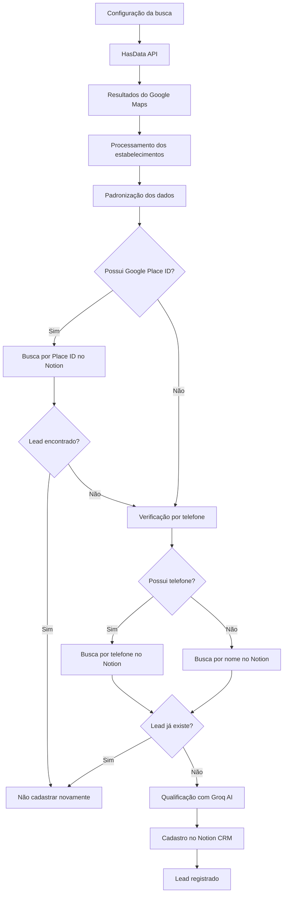

# Arquitetura do Projeto

## Visão geral

O projeto **Captação Automática de Leads com IA** é uma automação desenvolvida no n8n para identificar potenciais clientes, organizar suas informações, evitar registros duplicados e realizar uma qualificação comercial utilizando inteligência artificial.

A solução integra quatro componentes principais:

- **n8n:** responsável pela orquestração do processo.
- **HasData:** responsável pela coleta de estabelecimentos encontrados no Google Maps.
- **Groq AI:** responsável pela análise e classificação dos leads.
- **Notion:** utilizado como CRM para armazenar e organizar os leads.

## Arquitetura da solução

O processo segue uma sequência de etapas:

1. Configuração do nicho e da localização desejada.
2. Consulta à API da HasData para buscar estabelecimentos.
3. Extração e processamento dos resultados.
4. Padronização das informações dos estabelecimentos.
5. Verificação de duplicidade no CRM.
6. Qualificação dos novos leads com inteligência artificial.
7. Cadastro dos leads no banco de dados do Notion.

## Fluxo de dados

## Componentes e responsabilidades

### n8n

Coordena todas as etapas da automação, conectando as APIs, processando os dados, executando as verificações e controlando as decisões do fluxo.

### HasData

Realiza a consulta de estabelecimentos no Google Maps a partir dos parâmetros de busca definidos no workflow.

Os resultados podem conter informações como:

- Nome do estabelecimento.
- Categoria.
- Endereço.
- Telefone.
- Website.
- Avaliação.
- Quantidade de avaliações.
- Google Place ID.

### Groq AI

Recebe os dados padronizados dos estabelecimentos e realiza uma análise comercial.

A classificação considera duas dimensões:

**Prioridade:**
- Alta.
- Média.
- Baixa.

**Oportunidade:**
- Site.
- Agendamento.
- Automação.
- IA.

A IA também produz uma justificativa textual para a classificação.

### Notion CRM

Armazena os leads identificados e suas informações, incluindo os dados comerciais e a análise produzida pela inteligência artificial.

## Estratégia de deduplicação

Para reduzir